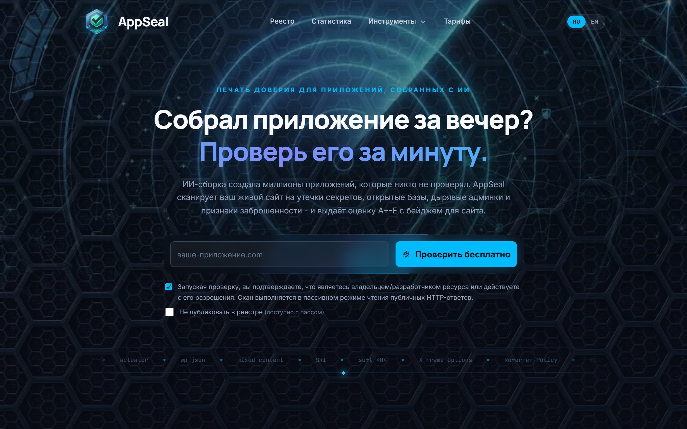
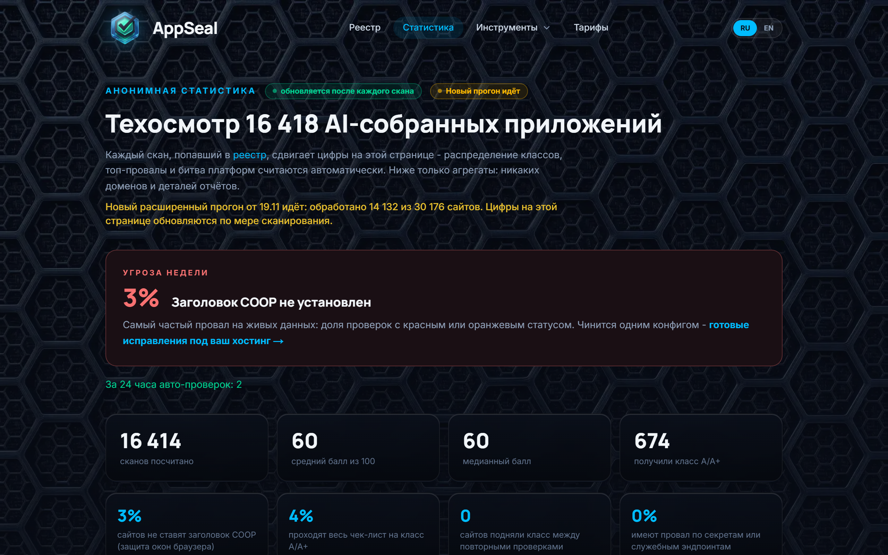

<p align="center">
  
</p>

<h1 align="center">AppSeal</h1>

<p align="center">
  <b>The trust seal for AI-built apps.</b><br>
  Built an app in an evening with v0, Lovable, Bolt or Cursor?<br>
  Check it in a minute before you ship it.
</p>

<p align="center">
  <a href="https://appseal.online"></a>
</p>

<p align="center">
  <a href="https://appseal.online">Website</a> ·
  <a href="https://appseal.online/registry">Registry</a> ·
  <a href="https://appseal.online/stats">Stats</a> ·
  <a href="https://appseal.online/api">JSON API</a> ·
  <a href="https://t.me/AppSeal_Monitor_Bot">Telegram bot</a>
</p>

---



## What it does

AppSeal is an external black-box scanner for AI-built web apps. Point it at a live URL
and it runs **125 checks** in about a minute - no install, no signup for the first scan.

| Category | Checks | What it catches |
|---|---|---|
| Secrets & leaks | 21 | exposed `.env` files, API-key signatures, Firebase / Supabase configs |
| Security headers & TLS | 26 | missing CSP / HSTS / COOP, open redirects, cert expiry |
| Admin panels & auth | 27 | exposed dashboards, actuator endpoints, wp-json, swagger |
| Liveness & content | 23 | soft-404 shells, default pages, tiny empty sites, mixed content |
| AI-trust & hygiene | 18 | meta / OG hygiene, canonical, favicon, abandoned-project signals |

The result is an **A+ … E grade** with a plain-language fix plan, an embeddable trust
badge and a public verification page for every scan.

## Quick start

**1. Scan on the web** - paste a URL at [appseal.online](https://appseal.online).
The first scan is free, no signup required.

**2. Scan from Telegram** - open [@AppSeal_Monitor_Bot](https://t.me/AppSeal_Monitor_Bot),
send a bare domain or `/scan example.com`. The bot also runs scheduled watchdog scans
and weekly digests for hosts you monitor.

**3. Embed the badge** for any host you scanned - it links to the public verification page:

```markdown

```

**4. Integrate via JSON API** - status, grade and per-category results in one call.
Schema and live playground: [appseal.online/api](https://appseal.online/api).

## Public registry & stats

Every A / A+ scan is published in the [public registry](https://appseal.online/registry)
with an indexable link back to the app. Aggregate data from **30 000+ harvested
AI-built hosts** - grade distribution, most common failures, dead-site share - lives
on [/stats](https://appseal.online/stats).



## Pricing

| Plan | Price | What you get |
|---|---|---|
| Free | 0 ₽ | 1 scan/day, full report, embeddable badge |
| Launch Pass | 490 ₽ (~$6) | unlimited scans for one host for 7 days, PDF report |
| Pro Pass | 1 490 ₽ (~$19) | 30 days, scheduled watchdog scans, diffs & digest reminders |

Payments: YooKassa (RU cards) and Lava (international cards).

## How scanning works

The scanner identifies itself as `AppSeal-Scanner`, sends ~140 polite GET requests,
exploits nothing, and honors opt-out - see the [bot policy](https://appseal.online/bot).
Targets are validated against SSRF (no internal addresses).

## Self-hosting

This repository contains the production code (Next.js 16 + TypeScript, Redis/Upstash
for scan storage). Deployment paths - Vercel serverless or a Docker container - are
documented in [DEPLOY.md](DEPLOY.md); a hardening checklist lives in the docs.

## License

All rights reserved. The source is published as-is for transparency of the service;
reuse requires permission.

---

<p align="center">
  <b>AppSeal</b> - техосмотр для приложений, собранных с ИИ<br>
  <a href="https://appseal.online">appseal.online</a>
</p>

